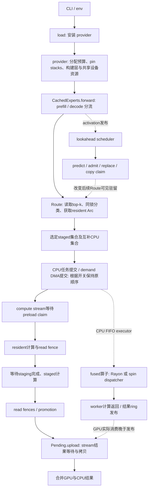

# M43 — 执行结构与数据流重构计划

**Status：** Completed（naiwa-rs 范围：R0/R1/R2/R3/R4/R5 及结构清理已分阶段完成并通过正确性与性能门；R6 fork 采样边界与 R7 harness 拆分留待后续独立里程碑）。

**Parent：** [M42 优化总结](m42-optimization-summary.md)、[M42 归因记录](m42-token-thread-sync-reads.md)。

**目标：** 在保持数值行为、CPU/GPU 工作选择、提交顺序和性能的前提下，让配置、缓存状态、执行计划、异步结果与诊断的数据流可直接阅读和审查。优化默认值晋升、调度算法改变与正确性协议修复不混入结构重构。

## 1. 当前结构与具体问题

以下基于当前工作区，包括尚未提交的实验实现；不是仅基于 main 上的文档。文件长度只是导航信息，不作为重构收益指标。

|位置|当前职责与问题|重构边界|
|---|---|---|
|`src/load.rs`、`src/moe/provider.rs`（约629行）|安装 provider、预算/设备资源、pin/warmup、构造各层；配置经 CLI、env、OnceLock 分散进入执行路径|区分启动配置、资源构建与每步执行|
|`src/moe/cached_layer.rs`（约1337行）|`Layers` 借用/恢复、activation channel、选择策略函数、`LayerState`、forward 分流、admit/replace/upload、promotion、prediction/background fill|优先机械拆文件，保留原对象与锁；之后再收窄接口|
|`src/moe/decode.rs`（约382行）|route、staging选择、CPU-first hook、CPU提交、resident/staged GPU、fence、promotion、结果汇合和日志交错|显式展示一次调用的计划与执行顺序；不新增调度器|
|`src/moe/stages/dma_miss.rs`|选择 staged experts、占用ring、修改hits/misses、before_dma回调与拷贝提交耦合|先提取纯选择结果，再明确提交边界；不提前分配/clone slot|
|`src/moe/stages/route.rs`|路由读取、同锁驻留分类、hit计数、slot Arc获取、诊断JSON|保留同锁快照与Arc获取，诊断数据准备显式化|
|`src/executor.rs`、`src/spin_pool.rs`|前者单线程FIFO任务执行与结果发布；后者是 fused CPU 算子的并行 dispatcher|名称/文档必须区分两层，不能误合并为同一个pool|
|`src/copy_stream.rs`（约731行）、`slot.rs`、`staging.rs`、`slab.rs`|设备传输、read fence、slot存储、staging ring、prefill借用相互依赖|公开所有权/同步契约，首阶段保留低层协议|
|`src/stats/*partition.rs`、`schedule.rs`|多套重复的event复用、TLS队列、后台writer；部分代码压缩在长行，schema和flush协议不同|先保留数据生产顺序，统一定义/错误语义，最后独立处理复用|
|fork `qwen4_split.rs`、`pipeline/sampling.rs`、`sampler.rs`|模型边界callback、采样资格、单序列GPU实验与观测标记交错|先整理接口/资格判定；不移动实际采样或放宽限制|
|`harness/attribution/*.py`|采集、进程管理、分析、硬件固定schema和实验配置共存；部分报告转换仍靠临时脚本|分清run、artifact validation、analysis；保留原命令兼容|

当前模块注释也有历史残留：例如“misses不在token路径加载”已经不能概括 demand staging；copy stream 的说明偏同步 upload，未覆盖 queue_async+completion claim。应让文字描述与当前真实路径一致，而不是让读者靠历史 milestone 拼接协议。

## 2. 当前真实数据流



图中的箭头是调用或依赖关系，不代表所有host/GPU操作串行。`Pending.upload` 是排队消费，不代表CPU任务已在host join。prefill借用/归还slab还会改变slot可用性，不能从缓存生命周期图中省略。

## 3. 必须保留的契约

### 3.1 所有权与并发

- route分类与捕获resident slot的Arc处于同一state锁内；不能拆成先查ID、解锁后再找buffer。
- slot `expert` 已预留不等于 `buf` 已发布；上传失败必须保持原来的回滚与错误传播。
- `wait_for_readers` 用Arc引用计数判断读者是否退出。新增计划对象、诊断快照或guard不能额外长期持有Arc，否则会造成背压甚至自等待。
- 保留 `slab access → state` 等现有锁顺序，画出storage/ring/state之间实际获取关系；不得通过新增大锁统一“简化”。
- read fence在相关kernel提交之后记录；copy stream覆写前等待旧读者及fence。Arc存活和CUDA完成是两种不同保证。
- staging候选引用必须在ring复用前释放。promotion关闭仍需清理候选，不能把清理放进enabled条件。
- CPU-first hook当前位于ring锁内、acquire之前；提取接口不能偷偷把CPU激活读取、任务提交或ring占用移到其他位置。
- lookahead允许跳过过时预测；CPU activation是精确输入，不能复用advisory stale-drop语义。该现有原型默认关，不在重构里修协议。

### 3.2 数值与设备执行

保持route ID/weight bits、ranking tie-break、resident/staged/CPU选择、归约顺序、dtype和fallback选择。不得改变CUDA stream、event record/wait位置、promotion顺序、pool线程数/affinity或默认值。

不可用Drop自动提交GPU fence、发completion或发布结果：这些操作会失败，必须在可返回Result的位置显式执行。可增加轻量newtype/校验，但不以一套泛化trait/动态dispatch替代当前直接调用。

## 4. 目标模块（逐步演进，不一次搬完）

```text
src/moe/
  provider.rs                 # 构建与warmup，保留外部provider接口
  cached_layer.rs             # CachedLayer / LayerState / CachedExperts薄入口
  layer_registry.rs           # 原Layers注册、跨层借用恢复协调
  activation_channel.rs       # 原LookaheadChannel，保留协议和每层所有权
  cache_policy.rs             # 纯ranking/selection/victim函数
  cache_updates.rs            # 原admit/replace/upload/promotion，保留impl CachedLayer
  decode.rs                   # 直观可读的提交顺序
  stages/
    route.rs                  # 路由读取和分类
    dma_miss.rs               # staging selection与提交契约
    cpu_miss.rs / gpu.rs      # 计算与结果句柄
    preload.rs                # lookahead任务调度
  slot.rs / staging.rs / slab.rs / ...  # 初期不动底层布局
```

目标是责任清晰，不是文件越小越好。 第一阶段仍使用同一个CachedLayer对象，避免同时改变对象图、字段归属和执行顺序。

建议的中间数据类型（名称可在实施时调整）：

- `LayerCallMeta { layer, local_tick, rows }`：只表达现有本地身份，绝不冒充request/token ID。
- `StagingSelection`：专家ID与需要的选择元数据，按现有顺序构建；首阶段不持slot Arc、不复制大权重列表。
- `CpuSubmission`：显式区分尚未提交、无需任务、已提交Pending，替代 `cpu_submitted: bool + Option<CpuPending>` 的隐含组合。是否采用enum必须保持当前无任务分支和错误行为。
- 原 `RoutePlan` 的resident prefix和后续追加staged区间先文档化、再通过访问接口表达；不为了容器好看新增复制/分配。

## 5. 分阶段实施与可回退交付

|阶段|范围|验收与退出条件|
|---|---|---|
|R0：冻结基线|记录两个仓库HEAD/patch、binary SHA、参数、硬件拓扑；整理模块/锁/stream契约与测量配置|能够复现原实现；不以未提交源码不明的binary作为对照|
|R1：机械拆分|抽出registry、activation channel和纯策略函数；只移动定义/import/测试|编译与oracle通过；不改变字段、锁作用域、调用次序；编译器内联差异仍做性能检查|
|R2：配置入口|集中记录CPU-first、pool、promotion、诊断开关的有效配置；先保留原env解释/默认/初始化时机|逐项比较缺省/0/1/非法值；特别保留physical layout按存在判定等现有行为，不顺手统一为bool|
|R3：显式执行计划|纯staged选择与提交分开命名，替代CPU提交bool+Option；decode显示所有同步边界|route/assignment诊断逐记录一致；相同锁、Arc释放与GPU提交顺序；热路径分配/clone不增加|
|R4：cache update接口|移动更新impl、收窄跨模块直接state访问；记录预留/发布/回滚和prefill借用状态表|admit/replace错误、候选清理、borrow恢复和失败路径不变；必要时保留直接入口，不强行封装锁|
|R5：诊断可维护性|格式化长行；拆event记录、buffer、writer、schema；model/head/schedule保持独立事件语义|默认关闭时零event/线程/文件；开启时无drops；schema变化提供version与旧数据读取；不直接合并不同flush机制|
|R6：fork采样边界|将资格与拒绝原因映射为同一来源；实验配置和observer接口分离|single/batch、greedy/topK1、logprobs、penalty、tool/recognizer、DRY、CPUfallback逐项保持；GPU top1与CPU边界一致性门|
|R7：harness和文档|将artifact校验和分析模块边界明确；统一结果生成入口；固定transcript测试|旧CLI可用；失败不重试、usage严格分母、独立进程统计、保存请求体和logprobs等契约不变|

每阶段独立commit，naiwa与fork修改分别提交并记录依赖顺序；必要时先做无行为新增接口，再迁调用者。不要将所有阶段放入一份大PR，也不与Strata代码清理捆绑。

## 6. 正确性与性能门

### 正确性

1. Rust现有测试、Python harness测试；有CUDA变更则release build/check，CPU fallback也必须覆盖。测试以锁/状态/错误契约为目标，避免只镜像重构代码。
2. 固定oracle：`frac=0 + --no-lookahead`、max-seqs4，首行与 `harness/m1/reference.oracle.txt` 字节一致；无drafting省略MTP深度参数。
3. 同配置no-lookahead控制比较完整文本与逐层工作记录：IDs、weight bits、resident/staged/CPU集合、顺序、条数；诊断独立于clean。两个prompt分别按请求位置比较。
4. 覆盖无CPU miss、无staged、promotion关闭、非CUDA、generic fallback、较宽verify rows、prefill借用恢复与错误清理。对新生命周期接口测试失败回滚，不能只跑正常decode。
5. MTP不能只验文本：逐请求proposed/accepted/outcome序列独立记录。若不能证明数值/工作一致，重构不得以“性能更好”替代正确性。

### 性能不退化（先约定门，实施时不挑轮）

- 每个触及热路径的阶段，原binary与候选同session交替测量，**每臂至少5次独立重启**，每进程3请求，每请求128completiontokens。保留每轮数值，不只给中位数。
- 至少覆盖默认Rayon/no drafting，以及当前opt-in组合physical5/CPU-first/swaps1/GPU sampling/MTP2；pool拓扑与模型/缓存参数固定。
- 两个prompt；关键阶段补短/长prefill、固定transcript多轮chat。真实各臂续写可另测，但后续输入分歧不能当严格TTFT回归证据。
- TPOT主门：配对退化中位数不超过 **0.3ms/token且不超过1%**。这是本计划的工程容忍阈值，不是宣称1%内统计等价。出现超阈值则不得合入该阶段，应回滚或定位后重新做完整独立对照。
- TTFT、SSE p95/p99、内存、GPU显存和启动资源一并报告；固定输入尾延迟/TTFT出现持续退化，即使TPOT通过也不能直接合入。建议预警线为配对退化中位数>5%；低噪声校准后再决定是否需要更严格门，不事后调阈值放行。
- 不新增每层heap分配、slot Arc长期持有、event创建或host/device同步；结构计数用于解释，不把“计数相同”视为性能不退化证明。
- MTP接受数不同必须标注：先在no-lookahead控制检查工作/数值，必要时扩大完整restart批次；不能用不同接受率下的TPOT单独判断重构成本。
- 所有失败、timeout、缺artifact和drops落盘并保留，不重试单请求补齐；新完整批次独立命名。基线与候选均不得启用诊断探针做clean验收。

## 7. 明确不包含的行为修改

- 不改CUDA graph路线，不改candle内部算子，不替换CPU/GPU kernel。
- 不推广任何实验参数为默认，不调整cache容量、frac、swaps、waves或MTP深度。
- 不在本计划里修mandatory activation的ack、结果ring失败空payload、取消清理或并发request关联；这些应独立正确性milestone，修复会改变行为，不能伪装机械重构。
- 不在重构中更换Arc计数协议、slot布局、event复用协议或result ring容量。
- 不把时间线host/GPU时钟桥补齐当作已经完成；request/step ID若新增，需要明确作用域与独立设计。

## 8. 完成定义

- 读 `decode.rs` 能找到一次调用中实际的route、选择、CPU/DMA顺序、preload/resident/staged依赖与结果汇合。
- `CachedLayer` 不再承载完整registry/channel/策略实现；模块各有所有权、锁顺序与stream契约。
- executor单任务调度与CPU算子pool概念明确；mandatory与advisory通道语义不再含混。
- 实验配置与诊断schema可定位；disabled路径无额外资源；旧harness产物可识别，错误不会静默降级。
- 各阶段正确性与性能门都有原始证据，不能只用最终组合的一个快数宣布通过。
- 实施后同步architecture/design与实际代码，记录本milestone依赖的fork提交；默认与算法策略保持原样。

## 9. 实施顺序建议

先做 **R0→R1**，收益是降低阅读与审查成本、风险最低；然后R2/R3分别验证。R4/R5是所有权与探针协议的高风险区，只有前置基线与接口契约清晰后推进。R6涉及fork与采样正确性，独立审查。本计划不以直接提升TPOT为目标；实施进展和未通过项记录如下。

## 10. 首次实施：R0 / R1

- 保存 `/tmp/m43-r0`：naiwa与fork的tracked/untracked源码归档、逐文件SHA256、patch及原binary；可审查清单归档于 `harness/m43/results/`。
- 首次R1仅机械抽出activation channel与纯cache policy；CUDA构建、Rust58通过/5忽略。
- 五轮clean配对：默认Rayon/no drafting候选回退中位数 **0.320ms/token**，超过0.3ms门限；physical5/MTP2组合为 **−0.069ms/token**。
- **未接受该拆分**，两处原文件按R0归档逐字恢复，新文件删除；release build/check通过。补丁与完整配置/manifest/report保留在 [M43实验记录](../../harness/m43/README.md)。
- 基线限制：原binary未在拆分前从快照源码重新构建，不能证明源码/binary一致；因此不能断言观测差异由拆文件导致。lookahead开启、文本/工作不同，也不能当同工作量成本比较。
- oracle、第二prompt等门未完成，不以单测替代。下一次先重新构建匹配源码的基线并跑oracle，再缩小为纯策略函数单项提取；不对同一候选重复采样直到获得有利中位数。
- R0尚需补源码与binary匹配证明；R1未完成，后续阶段不提前开始。默认与既有实验实现均未改变。

## 11. 第二次实施：源码匹配基线与纯策略提取

- 拆分前重新构建CUDA release并保存匹配源码/fork快照，补齐R0；baseline与candidate均通过frac0/no-lookahead/max-seqs4冻结oracle首行比较。
- 只移动五个纯策略函数，保留activation channel。构建与Rust58通过/5忽略。
- 默认Rayon/no drafting五轮配对中位数 **+0.050ms/token**；调优physical5/MTP2 **+0.591ms/token**，超过既定门限。
- **再次不接受该候选**：已回退本轮所有源代码变化，保留补丁、源码清单、oracle及全部逐轮证据，见 `harness/m43/README.md`。回退后release build/check通过。
- MTP文本/工作不同、未采接受数，不能断言纯函数搬迁导致慢0.591ms。下一步先量化同binary重复性，并建立no-lookahead MTP工作/接受身份控制；不重复同候选直到中位数有利，也不事后放宽门限。
- 首个候选oracle因外层命令总时限中断、未发生成请求；新完整采集通过，两组性能batch无失败/重试。第二prompt/完整工作身份门未完成，R1仍未完成。默认不变。

## 12. 完成记录（分阶段重构与全量门控验收）

以 `75641da` 为源码匹配冻结基线（`/tmp/naiwa-refactor-baseline/baseline`，SHA256 `187db5f7...`），按配置→清理→缺陷修复→模块拆分→热路径数据流与 `CachedLayer` 拆分顺序完成 6 个独立提交（均未改动 `../candle` 或 `../mistral.rs-iq4xs`，未改动任何默认值）：

1. **Phase 3 (`6892597`) — 集中配置（对应 R2）：** 新增 `src/config.rs`（`RuntimeConfig` / `DiagConfig` / `EnvConfig::from_lookup`），收口全部 73 处 `NAIWA_*` 环境变量读取；保留原有存在性判定与默认关闭语义（含 `NAIWA_PLAN_TRIM` 默认关）。
   - 验收：Rust 61/61、冻结 oracle 字节一致、`--no-lookahead` `MOE_WORK` 6,192/6,192 字节一致；5 轮配对中位数：默认 **-0.618 ms/tok**、调优/MTP2 **-0.272 ms/tok**。
2. **Phase 2 (`32785d4`) — 死代码与非 CUDA stub 清理：** 删除未使用 `src/moe/arena.rs`、死函数/静态量与冗余 `capture_bank` 返回值；修复 `provider.rs` 错误 `#[cfg(feature = "cuda")]` 与 `copy_stream::stub`。
   - 验收：Rust 55/55、冻结 oracle 字节一致。
3. **Phase 1 (`0d11c7b`) — 正确性与热路径修补：** 修复 `prefill_stream` 诊断自锁死锁；修复 `rings_exec` 持锁等待 `wait_for_readers`、缺失 `fence.record_reads` 与错误路径未恢复 slot；`decode.rs` 将预算计数分配/排序与 `Instant::now()` 门控到 `if budget`。
   - 验收：Rust 55/55、冻结 oracle 字节一致；5 轮配对中位数：默认 **-0.408 ms/tok**、调优/MTP2 **+0.187 ms/tok**（+0.49%）。
4. **Phase 4 (`d0419ca`) — `prefill_stream` 拆分与 `stats` 统一（对应 R5）：** `src/prefill_stream.rs`（2,050 行）拆分为 `mod/planner/buffers/split/diagnostics.rs`；迁移 `src/stats/vram_peak.rs`；抽出 `src/stats/sink.rs`（`AsyncJsonSink<T>`）统一 4 个 JSONL 诊断 sink 并格式化长行。
   - 验收：Rust 55/55、Python harness 15/15、冻结 oracle 字节一致；实机验证 4 类 JSONL 诊断输出 0 drops。
5. **Phase 5a (`cfbd2fe`) — 显式执行计划（对应 R3）：** `RoutePlan` 拆分为 `resident` / `staged`（消除每层两次 `Vec<Vec<Hit>>` clone 与冗余 resident fence）；`early_cpu + cpu_submitted` 替换为 `CpuWork` enum。
   - 验收：Rust 55/55、冻结 oracle 字节一致；5 轮配对中位数：默认 **-0.189 ms/tok**、调优/MTP2 **-0.169 ms/tok**。
6. **Phase 5b+5c（对应 R1/R4/文档同步）：** `src/moe/cached_layer.rs`（1,337→396 行）拆出 `layer_registry.rs`、`activation_channel.rs`、`cache_policy.rs`、`cache_updates.rs`（关键热路径辅助函数标注 `#[inline]` 避免跨模块内联回退）；将全局 `slab::BORROWED`/`ACCESS` 替换为 per-provider `BorrowGate`；在 `src/moe/mod.rs` 文档化锁序 DAG 并同步 `docs/design.md`。
   - 验收：Rust 56/56（含新增 `BorrowGate` 单测）、Python harness 15/15、冻结 oracle 字节一致、`--no-lookahead` `MOE_WORK` 6,192/6,192 字节一致（`all_text_equal: true`）；5 轮配对中位数：默认 **-0.081 ms/tok**、调优/MTP2 **+0.215 ms/tok**（+0.58%），全部满足 `<= +0.3 ms/tok` 且 `<= +1%` 门限。
